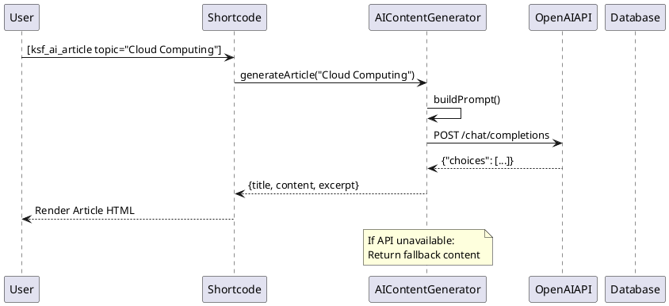
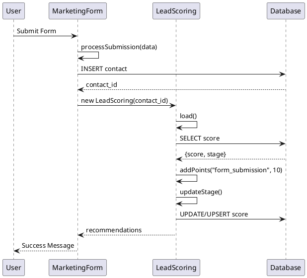

# ksf_Marketing - Architecture

## Document Information

| Field | Value |
|-------|-------|
| **Document ID** | ARCH-MARKETING-001 |
| **Module** | ksf_Marketing |
| **Project** | Marketing Automation & AI |
| **Version** | 1.0.0 |
| **Author** | KS Fraser Development Team |
| **Created** | 2024-01-15 |

---

## 1. Technical Architecture Overview

### 1.1 Architecture Pattern
The ksf_Marketing module follows **modular architecture** with clear separation between AI services, social media integrations, lead management, and campaign automation. It uses composition over inheritance and service-oriented design.

### 1.2 Module Classification
- **Type**: Business Logic Module with API Adapters
- **Namespace**: `Ksfraser\Marketing`
- **Platform**: Standalone with WordPress/FrontAccounting adapters

### 1.3 Architecture Layers

```
┌──────────────────────────────────────────────────────────────┐
│                    PRESENTATION LAYER                        │
│  ┌────────────────────────────────────────────────────────┐  │
│  │  Shortcodes:                                           │  │
│  │  - [ksf_ai_article]                                    │  │
│  │  - [ksf_social_post]                                   │  │
│  │  - [ksf_campaign_list]                                │  │
│  │  WordPress/Gutenberg Blocks                           │  │
│  └────────────────────────────────────────────────────────┘  │
└──────────────────────────────────────────────────────────────┘
                              │
                              ▼
┌──────────────────────────────────────────────────────────────┐
│                    SERVICE LAYER                             │
│  ┌────────────────────────────────────────────────────────┐  │
│  │  AIContentGenerator                                     │  │
│  │  SocialMediaPublisher                                  │  │
│  │  MarketingCampaign                                     │  │
│  │  DripCampaign / DripEmailSender                        │  │
│  │  LeadScoring                                          │  │
│  │  MarketingForm                                        │  │
│  │  ABTest                                               │  │
│  └────────────────────────────────────────────────────────┘  │
└──────────────────────────────────────────────────────────────┘
                              │
                              ▼
┌──────────────────────────────────────────────────────────────┐
│                    INTEGRATION LAYER                         │
│  ┌────────────────────────────────────────────────────────┐  │
│  │  OpenAI API Client                                    │  │
│  │  Twitter API Client                                   │  │
│  │  LinkedIn API Client                                  │  │
│  │  SMTP/Mail Service                                    │  │
│  └────────────────────────────────────────────────────────┘  │
└──────────────────────────────────────────────────────────────┘
                              │
                              ▼
┌──────────────────────────────────────────────────────────────┐
│                    DATA ACCESS LAYER                         │
│  ┌────────────────────────────────────────────────────────┐  │
│  │  Database Tables (via FrontAccounting DB layer)        │  │
│  │  - marketing_scheduled_posts                          │  │
│  │  - marketing_campaigns                                │  │
│  │  - marketing_drip_campaigns                            │  │
│  │  - marketing_drip_queue                                │  │
│  │  - marketing_contacts                                │  │
│  │  - marketing_lead_scores                              │  │
│  └────────────────────────────────────────────────────────┘  │
└──────────────────────────────────────────────────────────────┘
```

---

## 2. Class Diagram

### 2.1 AI Marketing Classes

```
┌─────────────────────────────────────────────────────────────┐
│                  AIContentGenerator                        │
├─────────────────────────────────────────────────────────────┤
│ - api_key: string                                         │
│ - model: string                                          │
├─────────────────────────────────────────────────────────────┤
│ + generateArticle(topic, tone): array                     │
│ + generateAd(product, platform): string                  │
│ + generateSocialPost(content, platform): string          │
│ + improveContent(content, goal): string                   │
│ + generateEmailCampaign(subject, template): array        │
│ - callAI(prompt): string                                 │
│ - fallbackGenerate(prompt): string                        │
└─────────────────────────────────────────────────────────────┘
                              │
                              │ uses
                              ▼
┌─────────────────────────────────────────────────────────────┐
│                    OpenAI API                               │
├─────────────────────────────────────────────────────────────┤
│ Endpoint: https://api.openai.com/v1/chat/completions     │
│ Model: gpt-4 (configurable)                               │
│ Max Tokens: 2000                                          │
└─────────────────────────────────────────────────────────────┘
```

### 2.2 Social Media Classes

```
┌─────────────────────────────────────────────────────────────┐
│                  SocialMediaPublisher                      │
├─────────────────────────────────────────────────────────────┤
│ - credentials: array                                       │
├─────────────────────────────────────────────────────────────┤
│ + publishToTwitter(content, media_path): bool             │
│ + publishToLinkedIn(content, title, media_path): bool    │
│ + schedulePost(content, schedule_time, platform): array  │
└─────────────────────────────────────────────────────────────┘
                              │
        ┌─────────────────────┼─────────────────────┐
        ▼                     ▼                     ▼
┌───────────────┐     ┌───────────────┐     ┌───────────────┐
│   Twitter    │     │  LinkedIn    │     │  Scheduled   │
│    API v2    │     │    API v2    │     │    Posts     │
└───────────────┘     └───────────────┘     └───────────────┘
```

### 2.3 Campaign Classes

```
┌─────────────────────────────────────────────────────────────┐
│                   MarketingCampaign                        │
├─────────────────────────────────────────────────────────────┤
│ + id: int                                                 │
│ + name: string                                            │
│ + type: string                                            │
│ + status: string                                          │
│ + channels: array                                         │
│ + leads_generated: int                                    │
│ + conversion_rate: float                                  │
├─────────────────────────────────────────────────────────────┤
│ + trackConversion(): bool                                 │
│ + static getActive(): array                               │
└─────────────────────────────────────────────────────────────┘

┌─────────────────────────────────────────────────────────────┐
│                      DripCampaign                          │
├─────────────────────────────────────────────────────────────┤
│ + id: int                                                 │
│ + name: string                                            │
│ + trigger: string                                         │
│ + steps: array                                            │
│ + status: string                                          │
├─────────────────────────────────────────────────────────────┤
│ + addStep(step): void                                     │
│ + executeForContact(contact_id): array                    │
│ + static find(id): ?DripCampaign                         │
│ + static findByTrigger(trigger): array                    │
└─────────────────────────────────────────────────────────────┘

┌─────────────────────────────────────────────────────────────┐
│                    DripEmailSender                         │
├─────────────────────────────────────────────────────────────┤
│ + static processQueue(): int                              │
│ - static sendEmail(contact_id, subject, body): bool      │
└─────────────────────────────────────────────────────────────┘
```

### 2.4 Lead Management Classes

```
┌─────────────────────────────────────────────────────────────┐
│                      LeadScoring                          │
├─────────────────────────────────────────────────────────────┤
│ + contact_id: int                                         │
│ + score: int                                              │
│ + stage: string                                           │
│ + points_breakdown: array                                 │
├─────────────────────────────────────────────────────────────┤
│ + addPoints(reason, points): void                        │
│ + subtractPoints(reason, points): void                   │
│ + getRecommendations(): array                           │
│ - updateStage(): void                                    │
│ - save(): void                                           │
│ - getNextActions(): array                                │
└─────────────────────────────────────────────────────────────┘

┌─────────────────────────────────────────────────────────────┐
│                    MarketingForm                           │
├─────────────────────────────────────────────────────────────┤
│ + id: int                                                 │
│ + name: string                                            │
│ + html_content: string                                    │
│ + css_content: string                                     │
│ + fields: array                                           │
│ + submit_action: string                                   │
├─────────────────────────────────────────────────────────────┤
│ + render(): string                                       │
│ + processSubmission(data): array                         │
│ + static find(id): ?MarketingForm                        │
│ + static all(): array                                    │
└─────────────────────────────────────────────────────────────┘

┌─────────────────────────────────────────────────────────────┐
│                        ABTest                             │
├─────────────────────────────────────────────────────────────┤
│ + id: int                                                 │
│ + name: string                                            │
│ + type: string                                            │
│ + variants: array                                         │
│ + results: array                                          │
│ + status: string                                          │
├─────────────────────────────────────────────────────────────┤
│ + recordConversion(variant_id): void                     │
│ + recordView(variant_id): void                          │
│ + getWinner(): ?string                                   │
└─────────────────────────────────────────────────────────────┘
```

---

## 3. Data Flow

### 3.1 AI Content Generation Flow

```
┌─────────────┐    ┌─────────────────┐    ┌─────────────┐    ┌─────────────┐
│  User       │    │ AIContentGen    │    │ OpenAI API  │    │  Database   │
│  Request    │───▶│                │───▶│             │───▶│  (Cache)    │
└─────────────┘    └─────────────────┘    └─────────────┘    └─────────────┘
                          │                    │
                          │                    │
        ┌─────────────────┴───────────────────┐│
        │ Fallback if API unavailable         ││
        └─────────────────────────────────────┘
```

**Flow Details**:
1. User/shortcode requests content generation
2. `AIContentGenerator` receives topic/tone parameters
3. Constructs prompt for OpenAI API
4. Makes API call with authentication
5. Parses response and returns structured data
6. If API unavailable, returns fallback placeholder

### 3.2 Social Publishing Flow

```
┌─────────────┐    ┌─────────────────┐    ┌─────────────┐    ┌─────────────┐
│  Content    │    │ SocialMediaPub  │    │ Platform    │    │  Database   │
│  Creator    │───▶│                 │───▶│    API      │───▶│   (Log)     │
└─────────────┘    └─────────────────┘    └─────────────┘    └─────────────┘
                          │
                          ▼
                 ┌─────────────────┐
                 │  Transform      │
                 │  (Platform Opt) │
                 └─────────────────┘
```

### 3.3 Lead Scoring Flow

```
┌─────────────┐    ┌─────────────┐    ┌─────────────┐    ┌─────────────┐
│  Contact    │    │ LeadScoring│    │ Calculate   │    │  Database   │
│  Action     │───▶│            │───▶│   Score     │───▶│   (Save)    │
└─────────────┘    └─────────────┘    └─────────────┘    └─────────────┘
                          │
                          ▼
                   ┌─────────────┐
                   │ Determine   │
                   │   Stage     │
                   └─────────────┘
                          │
                          ▼
                   ┌─────────────┐
                   │ Recommend   │
                   │   Actions   │
                   └─────────────┘
```

### 3.4 Drip Campaign Flow

```
┌─────────────┐    ┌─────────────┐    ┌─────────────┐    ┌─────────────┐
│  Trigger   │    │ DripCampaign│    │ Schedule    │    │  Email      │
│  Event     │───▶│             │───▶│   Steps     │───▶│   Queue     │
└─────────────┘    └─────────────┘    └─────────────┘    └─────────────┘
                                                           │
                                                           ▼
                          ┌─────────────┐    ┌─────────────┐
                          │ DripEmail   │───▶│   SMTP      │
                          │  Sender     │    │   Server    │
                          └─────────────┘    └─────────────┘
```

---

## 4. Database Schema

### 4.1 Core Tables

#### Table: marketing_scheduled_posts
```sql
CREATE TABLE IF NOT EXISTS 0_marketing_scheduled_posts (
    id INT AUTO_INCREMENT PRIMARY KEY,
    content TEXT NOT NULL,
    schedule_time DATETIME NOT NULL,
    platform VARCHAR(50) NOT NULL,
    status ENUM('scheduled', 'published', 'failed') DEFAULT 'scheduled',
    created_at DATETIME DEFAULT CURRENT_TIMESTAMP,
    published_at DATETIME,
    INDEX idx_status (status),
    INDEX idx_schedule (schedule_time)
) ENGINE=InnoDB DEFAULT CHARSET=utf8mb4;
```

#### Table: marketing_campaigns
```sql
CREATE TABLE IF NOT EXISTS 0_marketing_campaigns (
    id INT AUTO_INCREMENT PRIMARY KEY,
    name VARCHAR(255) NOT NULL,
    type VARCHAR(50) NOT NULL,
    status ENUM('draft', 'active', 'paused', 'completed') DEFAULT 'draft',
    channels JSON,
    leads_generated INT DEFAULT 0,
    conversion_rate DECIMAL(5,2) DEFAULT 0,
    start_date DATE,
    end_date DATE,
    created_at DATETIME DEFAULT CURRENT_TIMESTAMP,
    INDEX idx_status (status),
    INDEX idx_dates (start_date, end_date)
) ENGINE=InnoDB DEFAULT CHARSET=utf8mb4;
```

#### Table: marketing_drip_campaigns
```sql
CREATE TABLE IF NOT EXISTS 0_marketing_drip_campaigns (
    id INT AUTO_INCREMENT PRIMARY KEY,
    name VARCHAR(255) NOT NULL,
    trigger VARCHAR(50) NOT NULL,
    steps JSON NOT NULL,
    status ENUM('draft', 'active', 'paused') DEFAULT 'draft',
    created_at DATETIME DEFAULT CURRENT_TIMESTAMP,
    INDEX idx_trigger (trigger),
    INDEX idx_status (status)
) ENGINE=InnoDB DEFAULT CHARSET=utf8mb4;
```

#### Table: marketing_drip_queue
```sql
CREATE TABLE IF NOT EXISTS 0_marketing_drip_queue (
    id INT AUTO_INCREMENT PRIMARY KEY,
    campaign_id INT NOT NULL,
    contact_id INT NOT NULL,
    subject VARCHAR(255),
    body TEXT,
    scheduled_at DATETIME NOT NULL,
    status ENUM('pending', 'sent', 'failed') DEFAULT 'pending',
    created_at DATETIME DEFAULT CURRENT_TIMESTAMP,
    sent_at DATETIME,
    error TEXT,
    INDEX idx_status (status),
    INDEX idx_scheduled (scheduled_at),
    FOREIGN KEY (campaign_id) REFERENCES marketing_drip_campaigns(id)
) ENGINE=InnoDB DEFAULT CHARSET=utf8mb4;
```

#### Table: marketing_contacts
```sql
CREATE TABLE IF NOT EXISTS 0_marketing_contacts (
    id INT AUTO_INCREMENT PRIMARY KEY,
    name VARCHAR(255),
    email VARCHAR(255) NOT NULL,
    phone VARCHAR(50),
    company VARCHAR(255),
    source VARCHAR(100),
    created_at DATETIME DEFAULT CURRENT_TIMESTAMP,
    updated_at DATETIME,
    UNIQUE KEY idx_email (email),
    INDEX idx_company (company),
    INDEX idx_source (source)
) ENGINE=InnoDB DEFAULT CHARSET=utf8mb4;
```

#### Table: marketing_lead_scores
```sql
CREATE TABLE IF NOT EXISTS 0_marketing_lead_scores (
    id INT AUTO_INCREMENT PRIMARY KEY,
    contact_id INT NOT NULL,
    score INT DEFAULT 0,
    stage ENUM('lead', 'marketing_qualified', 'sales_qualified', 
              'opportunity', 'customer') DEFAULT 'lead',
    points_breakdown JSON,
    updated_at DATETIME,
    UNIQUE KEY idx_contact (contact_id),
    INDEX idx_stage (stage),
    FOREIGN KEY (contact_id) REFERENCES marketing_contacts(id)
) ENGINE=InnoDB DEFAULT CHARSET=utf8mb4;
```

### 4.2 Entity Relationship Diagram

```
┌───────────────────────┐       ┌───────────────────────┐
│ marketing_campaigns   │       │ marketing_drip_       │
├───────────────────────┤       │   campaigns           │
│ id (PK)               │       ├───────────────────────┤
│ name                  │       │ id (PK)               │
│ type                  │       │ name                  │
│ status                │       │ trigger               │
│ channels (JSON)       │       │ steps (JSON)          │
│ leads_generated       │       │ status                │
└───────────────────────┘       └───────────────────────┘
                                      │
                                      │ 1:N
                                      ▼
                              ┌───────────────────────┐
                              │ marketing_drip_queue  │
                              ├───────────────────────┤
                              │ id (PK)               │
                              │ campaign_id (FK)       │───┐
                              │ contact_id (FK)       │   │
                              │ subject               │   │
                              │ body                  │   │
                              │ scheduled_at          │   │
                              │ status                │   │
                              └───────────────────────┘   │
                                      │                  │
                                      │ (FK)              │
                                      ▼                  │
┌───────────────────────┐       ┌───────────────────────┐│
│ marketing_forms        │       │ marketing_contacts   ││
├───────────────────────┤       ├───────────────────────┤│
│ id (PK)               │       │ id (PK)              ││
│ name                  │       │ email                 │◀─┘
│ fields (JSON)         │       │ name                  │
│ submit_action         │       │ company               │
└───────────────────────┘       │ score (via join)      │
                                └───────────────────────┘
                                      │
                                      │ 1:1
                                      ▼
                              ┌───────────────────────┐
                              │ marketing_lead_scores │
                              ├───────────────────────┤
                              │ contact_id (FK)       │
                              │ score                 │
                              │ stage                 │
                              │ points_breakdown      │
                              └───────────────────────┘
```

---

## 5. File Structure

### 5.1 Module Directory Structure

```
ksf_Marketing/
├── ProjectDcs/
│   ├── ProjectDcs/
│   │   ├── Business Requirements.md
│   │   ├── Architecture.md
│   │   ├── Functional Requirements.md
│   │   ├── Use Case.md
│   │   ├── Test Plan.md
│   │   └── UAT Plan.md
│   ├── BABOK/
│   ├── UML/
│   └── RTM/
├── src/
│   └── Ksfraser/
│       └── Marketing/
│           ├── AIMarketing.php      (AI + Social classes)
│           ├── DripCampaigns.php     (Drip + AB Test classes)
│           └── LeadScoring.php        (Lead + Form classes)
├── includes/
│   └── ksf_marketing.php
├── tests/
│   └── Unit/
├── composer.json
├── phpunit.xml
└── README.md
```

### 5.2 Key Files Description

| File | Classes | Description |
|------|---------|-------------|
| `AIMarketing.php` | `AIContentGenerator`, `SocialMediaPublisher`, `MarketingCampaign` | AI and campaign classes |
| `DripCampaigns.php` | `DripCampaign`, `DripEmailSender` | Drip campaign automation |
| `LeadScoring.php` | `LeadScoring`, `MarketingForm`, `ABTest` | Lead management and testing |

---

## 6. Integration Architecture

### 6.1 External API Integrations

```
┌──────────────────────────────────────────────────────────────┐
│                    ksf_Marketing Module                       │
├──────────────────────────────────────────────────────────────┤
│                                                              │
│  ┌──────────────────┐  ┌──────────────────┐                │
│  │ OpenAI Integration │  │ Social Media    │                │
│  │ - GPT-4 API       │  │ - Twitter v2    │                │
│  │ - Chat Completions │  │ - LinkedIn v2   │                │
│  └──────────────────┘  └──────────────────┘                │
│                                                              │
│  ┌──────────────────┐  ┌──────────────────┐                │
│  │ Email Service     │  │ Form Processor   │                │
│  │ - PHP mail()      │  │ - Webhook        │                │
│  │ - SMTP            │  │ - API endpoint   │                │
│  └──────────────────┘  └──────────────────┘                │
│                                                              │
└──────────────────────────────────────────────────────────────┘
```

### 6.2 OpenAI Integration

| Component | Value |
|-----------|-------|
| Endpoint | `https://api.openai.com/v1/chat/completions` |
| Default Model | `gpt-4` |
| Max Tokens | 2000 |
| Authentication | Bearer Token |
| Config Key | `ksf_ai_api_key` |

### 6.3 Twitter API Integration

| Component | Value |
|-----------|-------|
| Endpoint | `https://api.twitter.com/2/tweets` |
| Authentication | OAuth 2.0 Bearer Token |
| Config Key | `twitter_api_key` |

### 6.4 LinkedIn API Integration

| Component | Value |
|-----------|-------|
| Endpoint | `https://api.linkedin.com/v2/ugcPosts` |
| Authentication | OAuth 2.0 Access Token |
| Config Keys | `linkedin_access_token`, `linkedin_org_id` |

---

## 7. Error Handling

### 7.1 Error Categories

| Category | Handling | Fallback |
|----------|----------|----------|
| API Timeout | Log and retry once | Fallback content |
| Invalid API Key | Log error | Disable feature |
| Rate Limit | Exponential backoff | Queue for later |
| Network Error | Log and alert | Graceful degradation |

### 7.2 AI Fallback Content

When OpenAI API is unavailable:
```
AI-generated content for: [topic]...

This is a placeholder. Configure your AI API key in settings for real content generation.
```

### 7.3 Social Publishing Fallback

When platform API unavailable:
- Store post in database with 'failed' status
- Log error for manual retry
- Display warning in admin panel

---

## 8. Performance Considerations

### 8.1 Caching Strategy

| Data Type | Cache Duration | Cache Location |
|-----------|----------------|----------------|
| Generated content | 1 hour | Optional Redis |
| Campaign stats | 5 minutes | In-memory |
| Lead scores | Real-time | Database |
| Scheduled posts | Until published | Database |

### 8.2 Rate Limiting

| API | Limit | Handling |
|-----|-------|----------|
| OpenAI | 60 requests/min | Queue + retry |
| Twitter | 50 posts/day | Schedule enforcement |
| LinkedIn | 25 posts/day | Schedule enforcement |

### 8.3 Batch Processing

- Drip queue processor: 50 emails per batch
- Social posts: Immediate for live, batch for scheduled
- Lead scoring: Real-time on action

---

## 9. UML Sequence Diagrams

### 9.1 AI Article Generation Sequence



### 9.2 Lead Scoring Sequence



---

## 10. Security Architecture

### 10.1 API Key Storage
- API keys stored in WordPress options or FA config
- Never hardcoded or committed to repository
- Environment variable support for production

### 10.2 Input Validation
- All user inputs sanitized via `db_escape()`
- HTML content escaped via `htmlspecialchars()`
- JSON validation on API responses

### 10.3 Access Control
- WordPress user capability checks
- FA permission system integration
- Admin-only configuration

---

**Document Owner**: KS Fraser Development Team  
**Review Status**: Pending